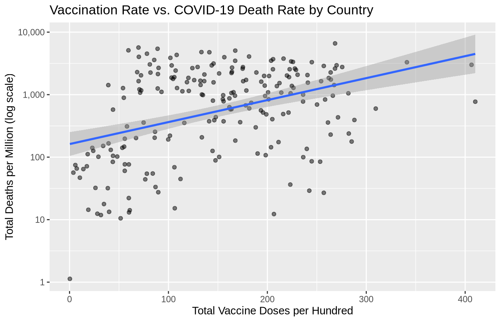
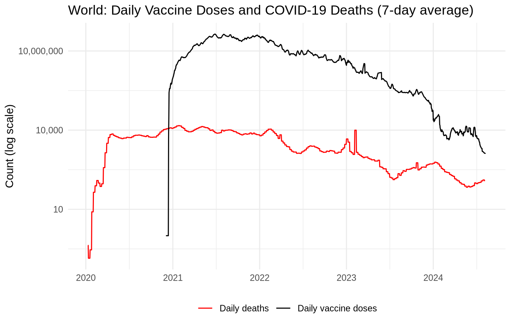

# COVID-19 Vaccination and Death Rates

A cross-country statistical analysis of the relationship between COVID-19 vaccination rates and COVID-19 mortality and infection rates, using simple and multiple linear regression. Final project for **STAT 240 (Data Science Modeling I)** at UW-Madison.

📊 **[View the full report](https://youngjoon020428-cell.github.io/covid-vaccination-analysis/project_final_report.html)**

## Team and My Role

This analysis began as a team project for STAT 240 at UW-Madison. After the course ended, I revised the analysis on my own; the revision is described below.

## Revision History

**Original submission:** The original report concluded that higher vaccination rates were significantly associated with lower COVID-19 mortality (p < 2.2e-16).

**Revision (November 2026):** On review, I found that the original regressions had been fit on daily country-level rows (~65,000 rows) instead of one observation per country. Repeated measurements of the same country were treated as independent, which made the p-values far smaller than they should have been. I rebuilt the analysis with these changes:

- Fit the models on one row per country (n = 209)
- Log-transformed the skewed outcomes and used cumulative cases instead of peak daily cases
- Fixed the country filter (South Africa had been excluded by mistake, and some aggregate regions had been kept)
- Added multiple regression adjusting for population age (% aged 65+) and income (GDP per capita)
- Added a timing analysis comparing vaccination by the end of 2021 with deaths after 2021

The corrected analysis reverses the original conclusion. The unadjusted association is *positive*, driven by confounding. After adjustment, vaccination is not a significant predictor of country-level mortality.

## Overview

The project asks whether countries with higher COVID-19 vaccination coverage have lower reported death and case rates, and whether that relationship holds after accounting for population age and national income. The analysis uses data from [Our World in Data](https://ourworldindata.org/covid-vaccinations), with each country as one observation (n = 209 countries; 178 with complete covariates).

**Hypotheses** (for the vaccination slope β₁):
- **H₀:** β₁ = 0 (no linear association between vaccination rate and log death/case rate)
- **Hₐ:** β₁ ≠ 0

## Key Findings

| Model (outcome on log scale) | β (per +1 dose per 100) | p-value | R² |
|---|---|---|---|
| Deaths, unadjusted | +0.0081 | < 0.0001 | 0.16 |
| Deaths, adjusted for age 65+ and GDP | −0.0027 | 0.055 | 0.59 |
| Cases, unadjusted | +0.0147 | < 0.0001 | 0.38 |
| Cases, adjusted | +0.0026 | 0.039 | 0.74 |
| Deaths after 2021 vs. vaccination by end of 2021, adjusted | +0.0022 | 0.38 | 0.66 |

- **The unadjusted association is positive.** Countries with more vaccine doses per person reported *more* COVID-19 deaths and cases per million, which is the opposite of the original hypothesis.
- **The positive slope reflects confounding.** Wealthier countries with older populations vaccinated more, and they also have more high-risk residents and more complete testing and death reporting.
- **After adjusting for age and GDP,** the vaccination coefficient for deaths becomes slightly negative but is not significant at α = 0.05. Age and income explain far more of the cross-country variation.
- **Takeaway:** Country-level cross-sectional data cannot show whether vaccines reduce deaths (the ecological fallacy). Individual-level studies are the appropriate design for that question.

### Figures

Countries with more vaccine doses per person reported *more* deaths per million in the unadjusted data. The upward slope reflects confounding by age and income:

Worldwide, daily deaths stayed close to their earlier level through the 2021 vaccine rollout and declined mainly from 2022 onward:

## Repository Contents

| File | Description |
|---|---|
| `project_final_report.Rmd` | R Markdown source: data cleaning, exploratory plots, regression models, diagnostics, and write-up |
| `analysis.R` | R code extracted from the report, runnable on its own |
| `project_final_report.html` | Rendered report (knit output) |
| `figures/` | Key figures shown in this README |
| `data/` | Instructions for obtaining the dataset (raw data not included) |

## Reproducing the Analysis

1. Download `owid-covid-data.csv` from [OWID's GitHub repo](https://github.com/owid/covid-19-data/blob/master/public/data/owid-covid-data.csv). The final version of the dataset covers data through 2024-08-14.
2. Place it in the `data/` folder.
3. Install the required packages: `install.packages(c("tidyverse", "modelr", "broom", "knitr", "rmarkdown"))`
4. Knit `project_final_report.Rmd` from the repository root. All numbers in the report are computed inline from the data.

## Methods

- **Tools:** R, tidyverse (dplyr, ggplot2), modelr, broom, knitr
- **Data preparation:** Kept only individual countries (rows with a `continent` value), then reduced each country to one row containing its latest cumulative values
- **Models:**
  - Simple linear regression: `log(deaths or cases per million) ~ vaccinations per hundred`
  - Multiple regression adding `% aged 65+` and `log(GDP per capita)` as confounders
  - Timing analysis: vaccination by end of 2021 vs. deaths occurring after 2021
- **Diagnostics:** Residuals vs. fitted plots and normal Q-Q plots

## Limitations

- Ecological, cross-sectional design: results describe countries, not individuals, and do not establish causation
- Confirmed deaths and cases depend on testing capacity and reporting quality, which vary with income
- Only age and GDP are adjusted for; comorbidities, prior infection, policy responses, and variant timing are not
- `total_vaccinations_per_hundred` counts all doses and does not distinguish primary series from boosters

## Future Work

- Use excess mortality as the outcome to reduce reporting bias
- Add covariates such as diabetes prevalence, cardiovascular death rate, hospital capacity, and testing rates
- Use panel models that follow each country over time

## Citation

Mathieu, E., Ritchie, H., Ortiz-Ospina, E. et al. (2021). A global database of COVID-19 vaccinations. *Nature Human Behaviour*, 5, 947–953.
